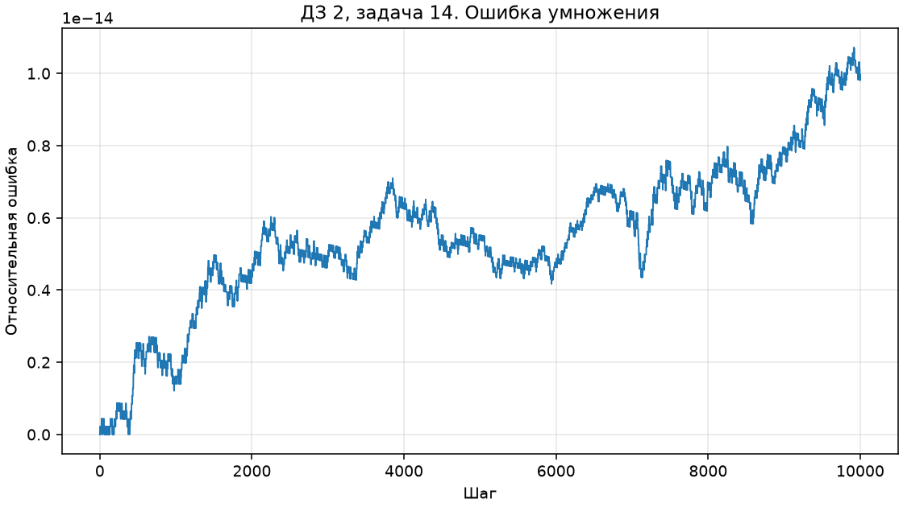

# ДЗ 2. Погрешность и округление

[Код решения](dz2.py)

## Запуск

```bash
python -m pip install numpy matplotlib
python dz2.py
```

## Абсолютная и относительная погрешность

### 1. Ручной счет

По абсолютной ошибке от лучшего к худшему идут `2.718`, `0.333`, `3.14`, `9.8`. По относительной `0.333` и `3.14` меняются местами, потому что ошибка делится на точное значение.

### 2. Мост и болт

Для моста вышло 3 м (0.24%), для болта 0.3 мм (3%). В метрах больше ошибка у моста, в процентах у болта.

### 3. Функция ошибки

Проверил `relative_error` на всех четырех парах. Функция возвращает долю, а если точное значение равно нулю, возвращает `inf`.

### 4. Точное значение

При `x = 47.3` и ошибке до 0.1% точное значение лежит примерно в `[47.25275, 47.34735]`. Границы чуть несимметричны, потому что в знаменателе точное значение.

### 5. Датчики

У B меньше допустимая ошибка при `|T| < 60 °C`. На границе `|T| = 60 °C` допуски равны, при большем `|T|` меньше ошибка у A.


## Значащие цифры и округление

### 6. Значащие цифры

В `0.004520`, `1.200`, `10.03` и `0.03050` по четыре значащие цифры. В `1200` и `250000` по записи не видно, какие нули значащие.

### 7. Запись измерения

Записал `4.74 ± 0.02`. Оставил три значащие цифры, потому что погрешность дана в сотых.

### 8. Округление до четного

На миллионе чисел вида `k + 0.5` округление вверх добавило 500 000, а округление до четного 69. При регулярных расчетах с деньгами округление вверх завышало бы сумму.

### 9. Промежуточное округление

Округлил слагаемые до тысячных и получил ошибку около 0.00138. Обычный цикл совпал с `fsum`, поэтому отношение ошибок не посчитать.


## Накопление ошибки

### 10. Сумма 0.1 и 0.2

Получилось `0.30000000000000004`. Проверка через `==` дала `False`, а `isclose` дал `True`, потому что разница всего около `5.55e-17`.

### 11. Потеря точности

При вычитании близких чисел вышла ошибка 11.02%. Для малого по модулю корня формула через произведение корней снизила ошибку с 25.5% до `7.91e-17`.

### 12. Накопление в цикле

Сложил миллион значений 0.1. У цикла получилась ошибка `1.33e-6`, а `sum` и `fsum` дали ровно 100 000 на моей версии Python.

### 13. Порядок сложения

Начал с малых чисел и получил ту же сумму, что и `fsum`. Если начать с больших, вклад малых пропадает, ошибка около `6.10e-5`.

### 14. Ошибка умножения

За 10 000 умножений ошибка дошла примерно до `1.07e-14`. Все три порога (`1e-9`, `1e-6` и `1e-3`) остались выше.



### 15. Рубли и копейки

В `Decimal` и целых копейках вышло ровно 10 000 руб. У `float` накопилось расхождение около `1.72e-7` руб.

### 16. Бонус

У среднего через цикл ошибка вышла около 17.44 машинного эпсилона. `sum`, `fsum` и `numpy.mean` совпали на этой выборке, их ошибка около 0.06 эпсилона.
