# Мини-задания по NumPy

Решения находятся в [numpy_exercises.py](numpy_exercises.py).

## Запуск

```bash
python -m pip install numpy
python numpy_exercises.py
```

## 1. Создание массива

Создал массив из чисел от 0 до 23 и придал ему форму `(6, 4)`.

```text
Форма: (6, 4)
Измерений: 2
Элементов: 24
Тип: int64
```

## 2. Изменение формы

Через `reshape` поменял форму на `(4, 6)`, потом на `(2, 3, 4)` и на `(24,)`. Проверил значения через `np.array_equal`, перед сравнением развернул массивы в одну строку.

```text
Числа сохранились:
True
True
True
```

## 3. Срез столбца

Взял третий столбец через `a[:, 2]` и заменил первый элемент на 999. Изменился и исходный массив, значит срез — это view, а не отдельная копия.

```text
До изменения: 2
После изменения: 999
```

После проверки вернул число 2, чтобы дальше работать с исходными данными.

## 4. Отбор по условию

Через `a[a > 10]` выбрал числа больше 10 и посчитал их среднее.

```text
Числа больше 10: [11 12 13 14 15 16 17 18 19 20 21 22 23]
Их среднее: 17.0
```

## 5. Вычитание среднего строки

Посчитал среднее каждой строки через `mean(axis=1, keepdims=True)` и вычел его из этой строки. `keepdims=True` оставляет форму средних `(6, 1)`, чтобы вычитание работало для каждой строки.

В каждой строке получилось `[-1.5, -0.5, 0.5, 1.5]`.

```text
Форма: (6, 4)
Суммы строк: [0. 0. 0. 0. 0. 0.]
Форма сохранилась: True
Суммы равны нулю: True
```

## ДЗ 4. Массивы NumPy

[Код ДЗ](homework4.py)

### 1. Свойства массива

Получился массив из 3 * 4 * 5 = 60 чисел. До следующего блока шаг 160 байт, строки 40 байт, числа 8 байт.

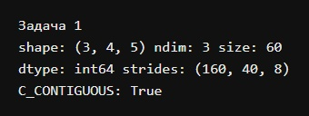

### 2. Деление и int8

`a / 2` создает новый массив, исходный не меняется. У `int8` диапазон от минус 128 до 127, поэтому при переполнении значения оборачиваются без ошибки.

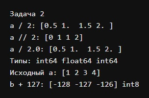

### 3. float32 и float64

Сравнение с Python `0.1` дало ноль для `float64`, поэтому отношение этих разностей не посчитать. С точным десятичным 0.1 ошибка `float32` больше в 268 435 456 раз. Для приблизительных расчетов хватит `float32`, при малых допусках и накоплении ошибки лучше `float64`.

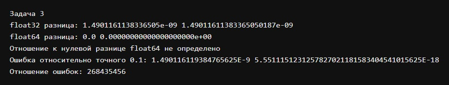

### 4. Размер типов

`float32` экономит 4 000 000 байт на миллионе элементов. При этом точность ниже, чем у `float64`.

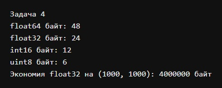

### 5. Изменение формы

После всех четырех изменений формы числа сохранились. Если достаточно поменять шаги по памяти, `reshape` обходится без копии, иначе копирует данные, например при некоторых изменениях формы после транспонирования.

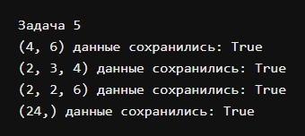

### 6. flatten и ravel

`flatten` создал копию, через `ravel` изменился и исходный массив. Для отдельного редактирования подойдет `flatten`, для чтения без лишней копии обычно удобнее `ravel`.

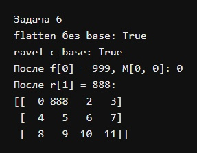

### 7. Новые оси

`v[:, None]` делает столбец, `v[None, :]` строку. `squeeze` убирает ось длины 1, а `.T` меняет строки и столбцы местами. При сложении получилась таблица сумм размером `(5, 5)`.

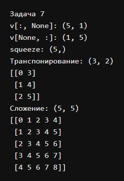

### 8. Транспонирование

У транспонированного массива шаги по памяти поменялись местами. Изменение через `.T` попало и в исходный массив.

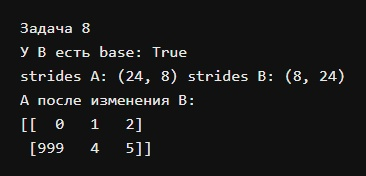

### 9. Умножение массивов

`*` умножает поэлементно, `@` считает матричное произведение. На диагональных матрицах оба результата совпали.

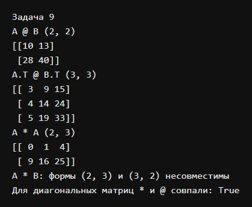

### 10. Оси

`axis=0` убирает ось строк и дает результаты по столбцам, `axis=1` убирает ось столбцов и дает результаты по строкам. `argmax(axis=0)` возвращает номера строк, `argmax(axis=1)` номера столбцов с максимумами. Сумма первого столбца равна 12, как и первый элемент `sum(axis=0)`.

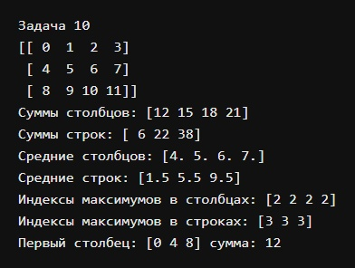

### 11. keepdims

`keepdims` оставил форму `(5, 1)` для средних и std строк. После нормировки средние близки к нулю, std равны единице.

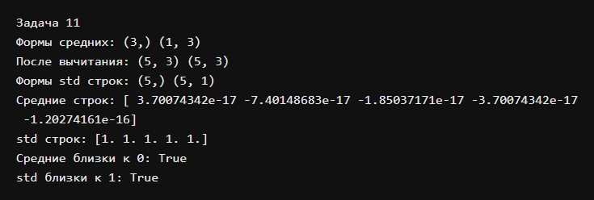

### 12. Срез и копия

Срез изменил исходные данные, с `.copy()` получилось отдельно поменять часть массива. View экономит память при чтении большого набора, но его изменение может испортить исходные данные эксперимента.

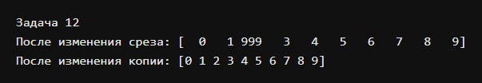

### 13. Маски и индексы

Нашлось 9 положительных чисел и 15 чисел между минус единицей и единицей. `a[a > 0]` содержит числа и имеет другую длину, поэтому для `&` нужны маски `(a > 0)` и `(a < 1)`. Выборка по `[0, 5, 10, 15]` берет числа с указанными индексами.

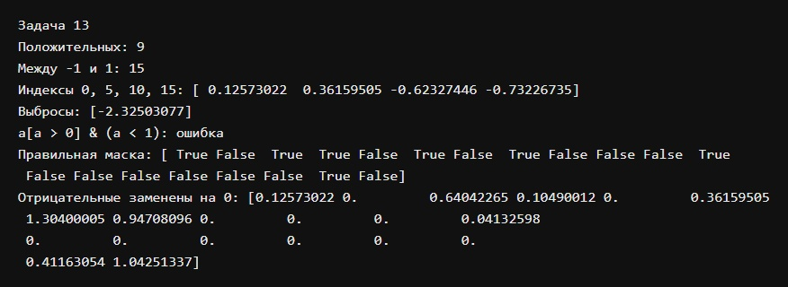

### 14. Нормировка и расстояния

Столбцы нормировались без цикла. Матрица расстояний имеет форму `(100, 100)`, нулевую диагональ и симметрична.

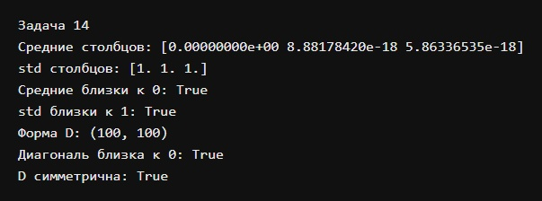

### 15. Измерения датчиков

Нашел один выброс в строке 7, столбце 2 и заменил его средним около 20.17. Копия перед заменой сохранила исходные измерения. Смена формы сохранила все числа. Broadcasting сработал при поиске выбросов, заполнении пропусков и нормировке, после которой средние близки к нулю и std к единице. Средние по строкам без `keepdims` дали бы неподходящую форму для вычитания.

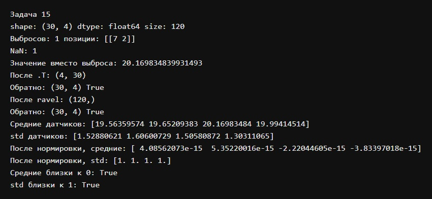
