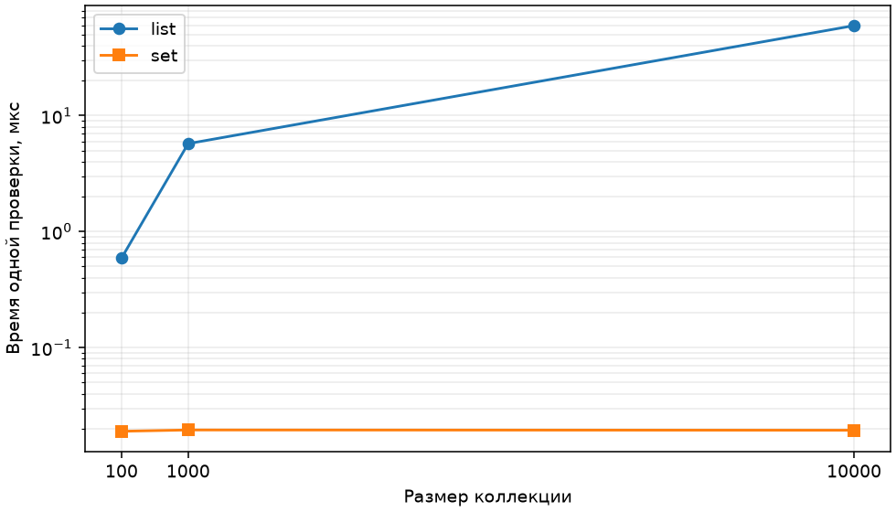
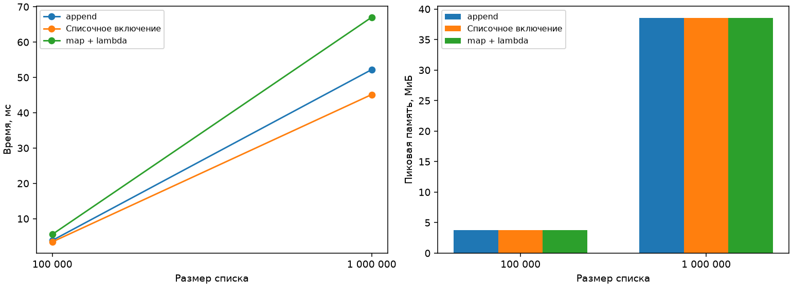

# Урок 6. Время и память

## 1. Поиск в list и set

Искал `-1`. Взял минимум из 5 замеров по 1000 проверок. Поиск в списке вырос с 0.59 до 59.55 мкс, у `set` остался около 0.019 мкс.

## 2. Список квадратов

На миллионе чисел списочное включение заняло 45 мс, `append` 52 мс, `map + lambda` 67 мс. Пиковая память у всех около 38.6 МиБ.

