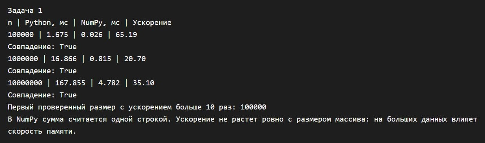
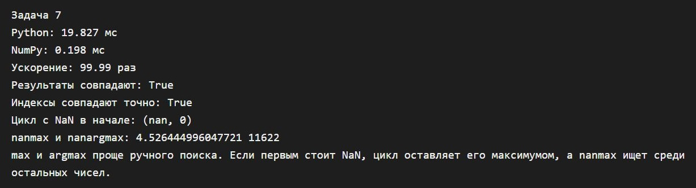
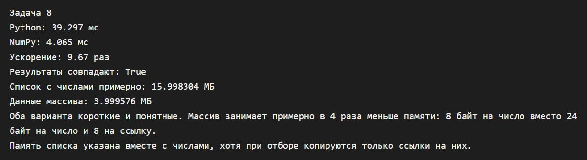
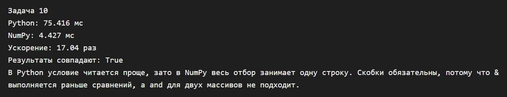
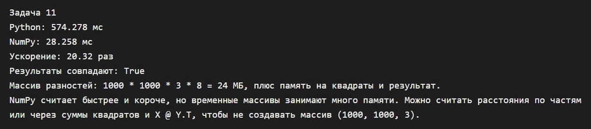

# Сравнение циклов и NumPy

Задачи с 1 по 11. Для каждого способа взято минимальное время из трех запусков. Данные одинаковые, seed = 42.

На скриншотах сохраненный вывод `compare_numpy_block1.py`, открытый в локальной странице.

## 1. Сумма массива

Уже на 100 000 чисел NumPy быстрее примерно в 65 раз. На остальных размерах ускорение тоже больше 10 раз, но растет неравномерно: влияет скорость памяти. Запись `a.sum()` проще цикла с накоплением суммы.

## 2. Среднее и стандартное отклонение

NumPy быстрее примерно в 17 раз, результаты совпали с точностью до `1e-12`. `mean()` и `std()` понятнее ручной суммы и суммы квадратов. Расчет std через отклонения от среднего устойчивее вычитания двух близких больших чисел.

## 3. sin(x) + x²

С NumPy получилось почти в 10 раз быстрее и формула занимает одну строку. Список с числами занимает примерно 32 МБ, а данные результата NumPy занимают 8 МБ. Но при вычислении еще создаются два временных массива по 8 МБ: для синуса и квадратов.

## 4. Замена значений за границами 0 и 1

`np.clip` быстрее примерно в 55 раз, изменено 658 628 элементов. Без строки `def` у цикла 9 строк, а у NumPy одна, то есть код в 9 раз короче. Границы 0 и 1 видны сразу, не нужно читать условия.

## 5. Сумма по строкам

NumPy быстрее примерно в 26 раз. У цикла 7 строк без `def`, у NumPy одна. `sum(axis=1)` проще поддерживать: сразу понятно, что нужна сумма каждой строки.

## 6. Вычитание средних по столбцам

NumPy быстрее примерно в 49 раз, средние столбцов после вычитания близки к нулю. Вместо 12 строк получается одна. В цикле приходится следить за индексами `i` и `j`, а broadcasting позволяет вычесть средние без ручных индексов.

## 7. Максимум и его индекс

NumPy быстрее примерно в 100 раз, максимум и индекс совпали. С `max()` и `argmax()` код короче, не нужно обновлять максимум вручную. Когда первым стоит NaN, цикл оставляет его максимумом, а `nanmax` и `nanargmax` находят ответ среди обычных чисел.

## 8. Отбор положительных чисел

NumPy быстрее примерно в 10 раз, оба варианта короткие. Список вместе с числами занимает примерно 16 МБ, а данные массива занимают 4 МБ, то есть примерно в 4 раза меньше. Это оценка памяти вместе с объектами чисел: при самом отборе список копирует ссылки на уже существующие числа.

## 9. Замена отрицательных чисел на модуль

NumPy быстрее примерно в 84 раза, оба способа меняют исходный объект. `np.abs(a, out=a)` короче цикла и экономит память под второй массив результата. Копии перед повторами нужны для одинаковых входных данных, время их создания не учитывалось.

## 10. Отбор чисел между −1 и 1

NumPy быстрее примерно в 17 раз и весь отбор занимает одну строку. Само условие `-1 < x < 1` в Python читается проще. В маске нужны скобки вокруг сравнений, потому что `&` выполняется раньше них; `and` для двух массивов не подходит.

## 11. Расстояния между точками

NumPy быстрее примерно в 20 раз и убирает вложенные циклы, хотя запись с новыми осями сложнее понять. Массив разностей занимает 24 МБ, плюс нужна память на квадраты и результат. Чтобы тратить меньше памяти, можно считать по частям или использовать формулу через суммы квадратов координат и `X @ Y.T`.
