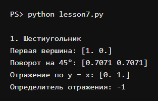
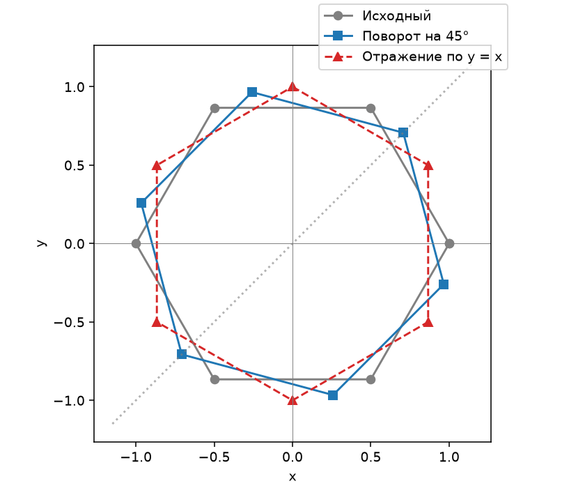
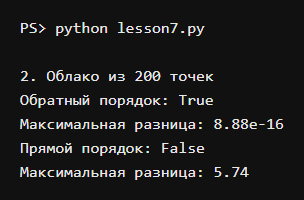
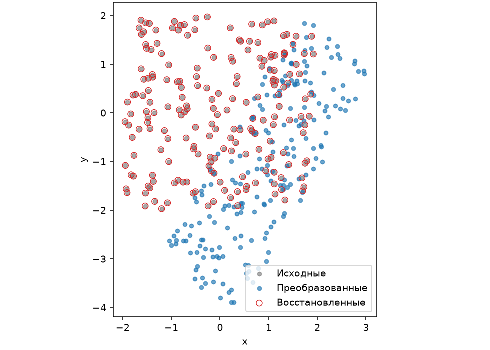

# Урок 7. Матричные преобразования

## 1. Шестиугольник

Повернул фигуру на 45° и отдельно отразил исходный контур по `y = x`. Симметрия дает тот же контур, что и поворот на 90°, но вершины идут в обратном порядке. Определитель отражения равен минус единице. У поворота он равен единице.

## 2. Облако точек

Сначала менял масштаб, потом поворачивал и переносил точки. Восстановление начал с переноса, потому что он был последним. Затем отменил поворот и масштаб.

