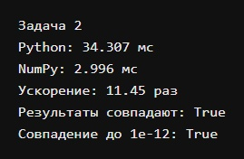
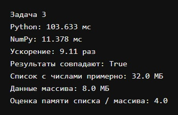
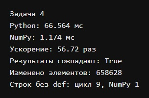
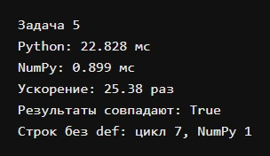
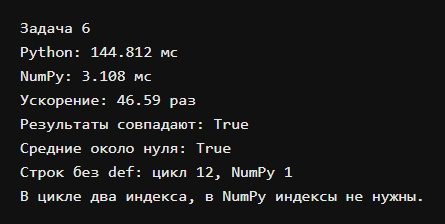
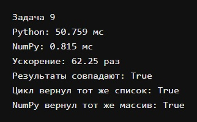
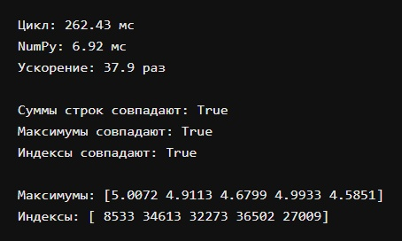

# Сравнение циклов и NumPy

## 1. Сумма массива

Разница больше 10 раз уже на 100 000 чисел. Ускорение меняется неравномерно из-за скорости памяти, а `a.sum()` проще ручного накопления суммы.

## 2. Среднее и стандартное отклонение

`mean()` и `std()` короче ручного расчета. NumPy считает отклонения от среднего, поэтому не нужно вычитать два близких больших числа.

## 3. sin(x) + x²

Формула NumPy занимает одну строку. Результат занимает 8 МБ вместо примерно 32 МБ у списка с числами, еще два временных массива по 8 МБ нужны для синуса и квадратов.

## 4. Ограничение значений

`np.clip` заменяет 9 строк цикла одной строкой. Границы видны сразу, без проверки каждого условия вручную.

## 5. Суммы строк

`sum(axis=1)` занимает одну строку вместо 7. По этой записи сразу понятно, что складываются элементы каждой строки.

## 6. Вычитание средних столбцов

После вычитания средние столбцов близки к нулю. Вместо 12 строк с двумя индексами достаточно одной строки с broadcasting.

## 7. Максимум и индекс

`max()` и `argmax()` короче ручного поиска. При NaN в начале цикл оставляет его максимумом, а `nanmax` и `nanargmax` находят ответ среди остальных чисел.

## 8. Положительные числа

Оба способа короткие, но NumPy хранит числа компактнее. Оценка списка с числами около 16 МБ, массива около 4 МБ, при отборе в список копируются ссылки на уже созданные числа.

## 9. Модуль на месте

Оба способа меняют исходный объект. `np.abs(a, out=a)` короче и не требует второго массива результата, копии перед повторными замерами создаются вне таймера.

## 10. Два условия

Условие `-1 < x < 1` в цикле проще читать. В NumPy нужны скобки вокруг сравнений: `&` выполняется раньше них.

## ДЗ 5. Суммы строк и максимумы столбцов

Код в [homework5.py](homework5.py). Для матрицы `(200_000, 5)` NumPy оказался быстрее примерно в 38 раз. `sum(axis=1)`, `max(axis=0)` и `argmax(axis=0)` заменяют два вложенных цикла.

