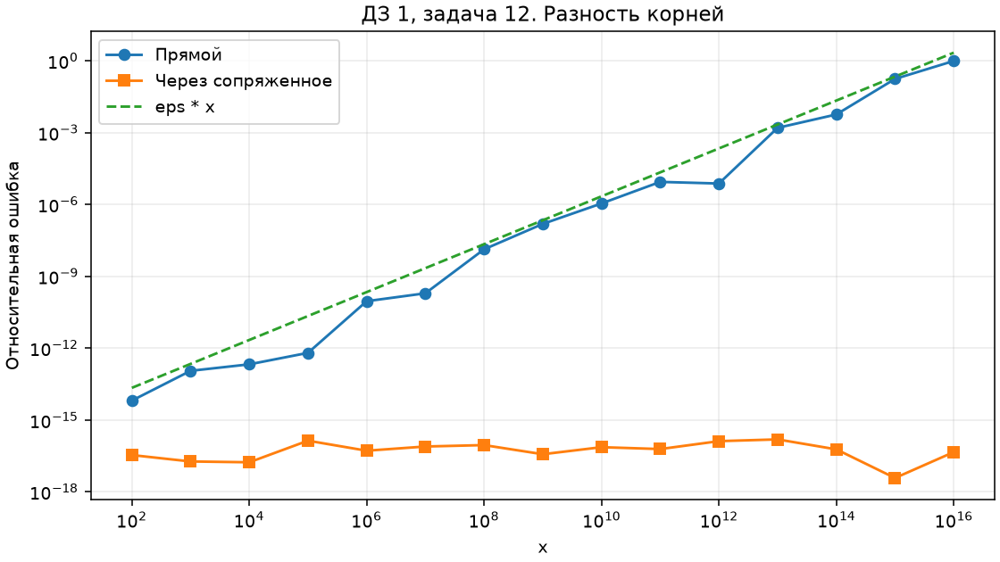

# ДЗ 1. Устойчивость алгоритма

[Код решения](dz1.py)

## Запуск

```bash
python -m pip install numpy matplotlib mpmath
python dz1.py
```

## Обусловленность

### 1. Число обусловленности

Самое большое число обусловленности у `x - 1` (1 000 001). У `ln(x)` получилось около 1000.5, у `sqrt(x)` 0.5, а у `sin(x)` в точке `pi/2` ноль.

### 2. Вычитание близких чисел

Для разности `a - b` оба числа обусловленности вышли около `1e8`. Увеличил `a` на `1e-9` и получил сдвиг разности примерно на 10%, как и ожидал.

### 3. Кратный корень

При `eps = 1e-2`, `1e-4` и `1e-6` корни сдвинулись от единицы на 0.1, 0.01 и 0.001. Уменьшение `eps` в 100 раз дает сдвиг только в 10 раз меньше.

### 4. Обусловленность и устойчивость

У `x / sqrt(x*x + 1)` число обусловленности не больше 1. При `x = 1e155` прямая формула дает 0 из-за переполнения квадрата, а с `hypot` получается 1.


## Устойчивость

### 5. Квадратное уравнение

При `b = 1e8` прямая формула ошиблась на 25.5%, а при `b = 1e12` вернула 0. С формулой через деление ошибка порядка `1e-17`.

### 6. Разность с косинусом

На моей сетке прямая формула впервые ошиблась больше чем на 1% при `x = 1e-8`. С `sin(x/2)` ошибка осталась около `1e-16` или меньше.

### 7. Разность корней

При прямом вычитании ошибка растет примерно как `x^1.02`. На `x = 1e16` она дошла до 100%, а у формулы с сопряженным осталась порядка `1e-16`.

### 8. Логарифм

При `x = 1e-16` сумма `1 + x` округляется до 1. Поэтому `log(1 + x)` дает 0, а `log1p(x)` сохраняет малую добавку.

### 9. Гармонический ряд

На 10 млн слагаемых у цикла ошибка около `1.55e-13`, у `sum` и `fsum` около `4.3e-17`. На моей сетке наклон ошибки цикла вышел 0.65, порог `1e-10` нигде не превышен.


## Эксперименты

### 10. Источники ошибки

Когда уменьшил `x` с `1e-2` до `1e-4`, ошибка выросла на 4.3 порядка. На том же `x = 1e-4` переход с `float64` на `float32` дал рост на 8.3 порядка, а формула с синусом в `float64` снизила ошибку на 7.5 порядка.

### 11. Эталон

При `x = 1e-16` оба способа дали 0. По `==` результаты совпали, но эталон оказался около `1e-16`, так что оба способа ошиблись на 100%.

### 12. Диапазон

Взял 15 точек от `1e2` до `1e16`. Пока прямая формула еще давала результат, наклон получился 1.03, почти как в оценке `eps * x`.



### 13. Воспроизводимость

Проверил на Python 3.14.5 и NumPy 2.5.4. С `seed = 42` суммы повторились, с `seed = 43` числа поменялись, а разница между `numpy.sum` и `fsum` осталась порядка `1e-14`.

### 14. Границы float

На примере с `nan` оба способа дали `nan`, а с одним `inf` дали `inf`. При сложении `inf` и `-inf` цикл вернул `nan`, а `fsum` выдал `ValueError`.

### 15. Мини-отчет

Сравнил `log(1 + x)` и `log1p(x)` на 16 точках от `1e-1` до `1e-16`. Эталон посчитал в mpmath с точностью 50 знаков.

Прямая формула укладывается в 1% до `x = 1e-14` включительно, а при `x = 1e-16` дает 0. Максимальная ошибка `log1p` на этой сетке составила `1.83e-16`.

### 16. Бонус

При `r = 1` и `mu = 1e-16` вычитание логарифмов дает 0. С `-log1p(mu/r)` получилось около `-1e-16`. [Пример из SciPy](https://github.com/scipy/scipy/issues/11465)
